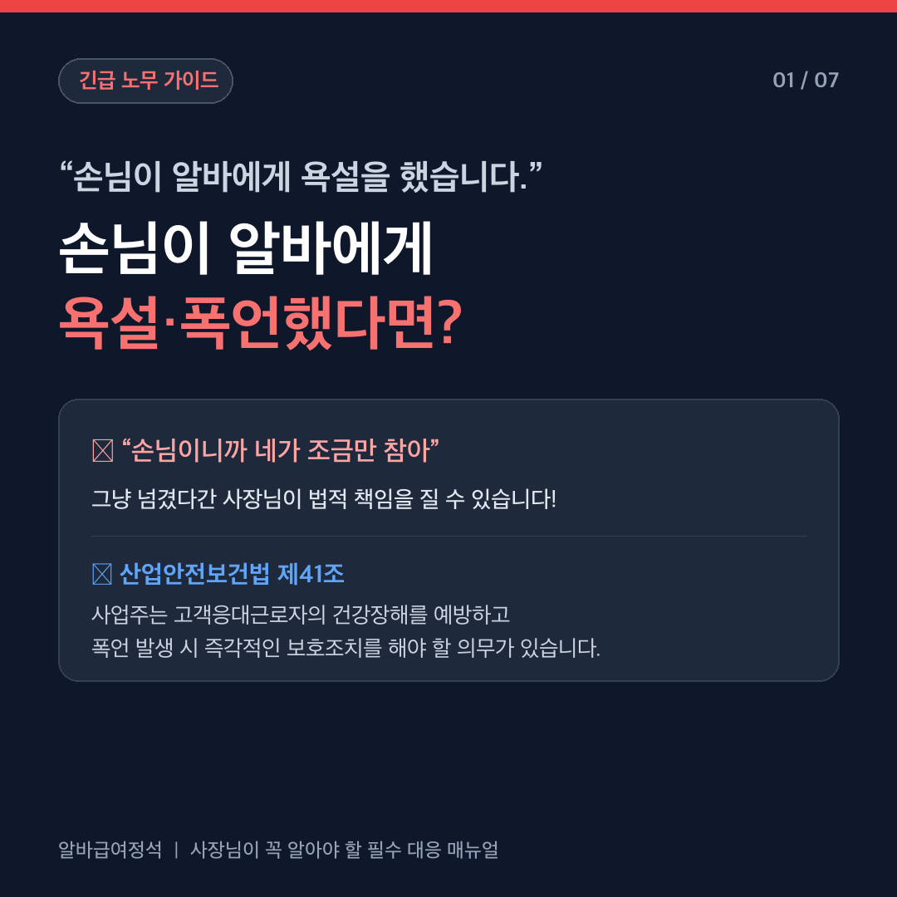
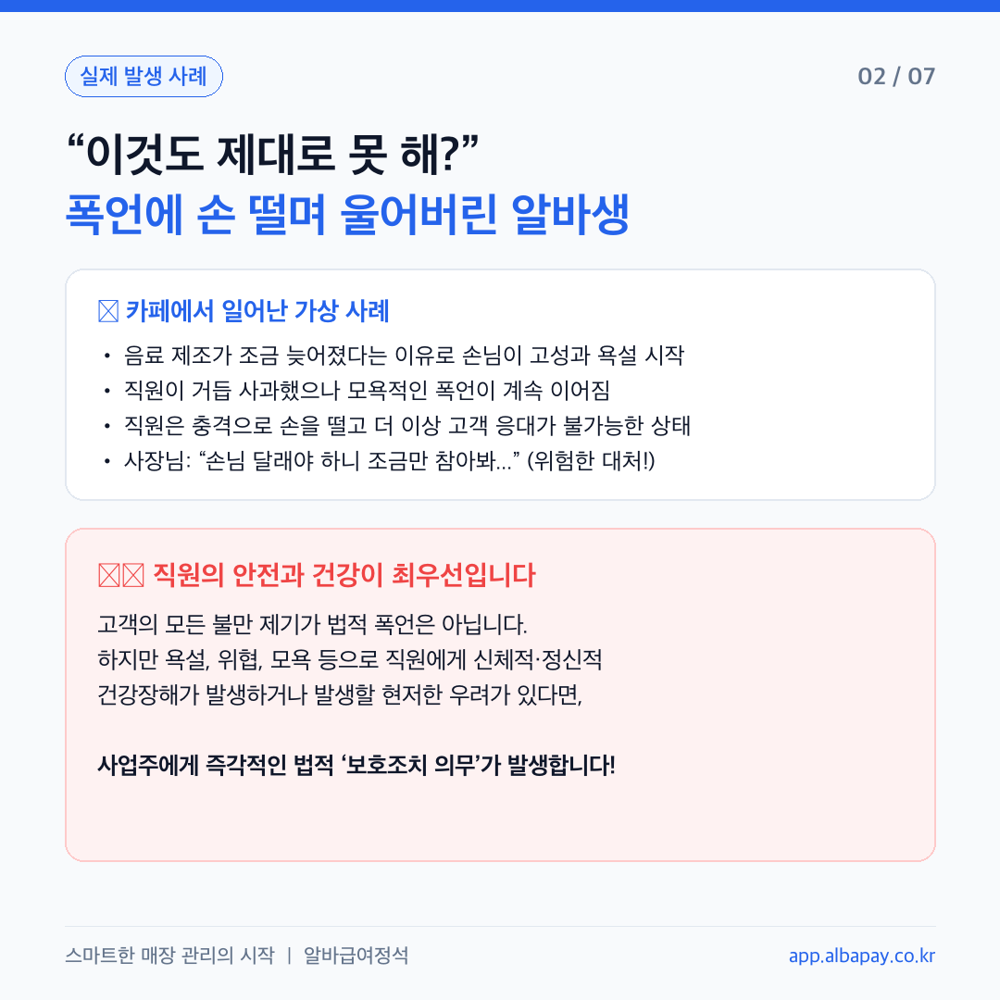
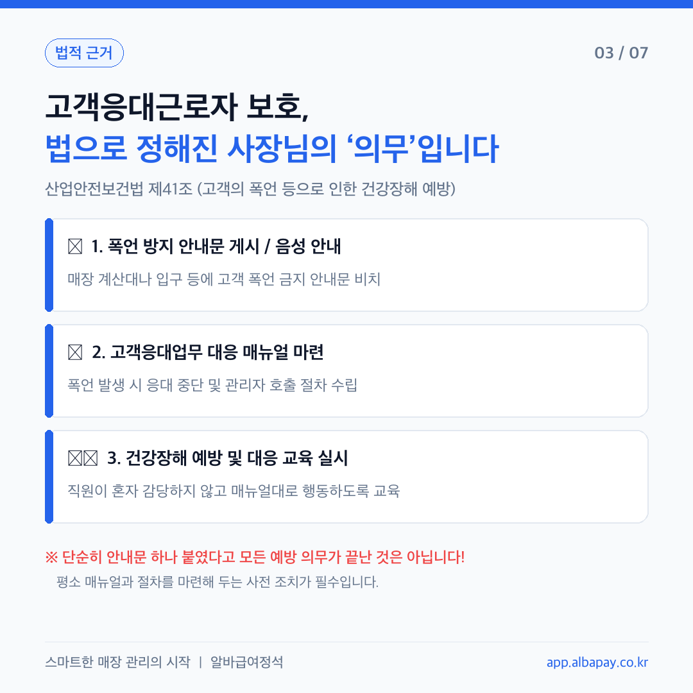
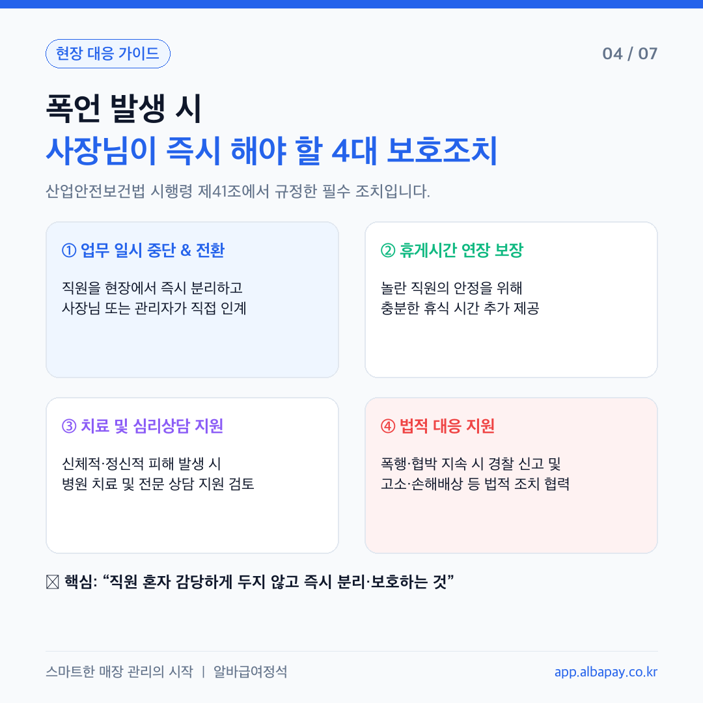
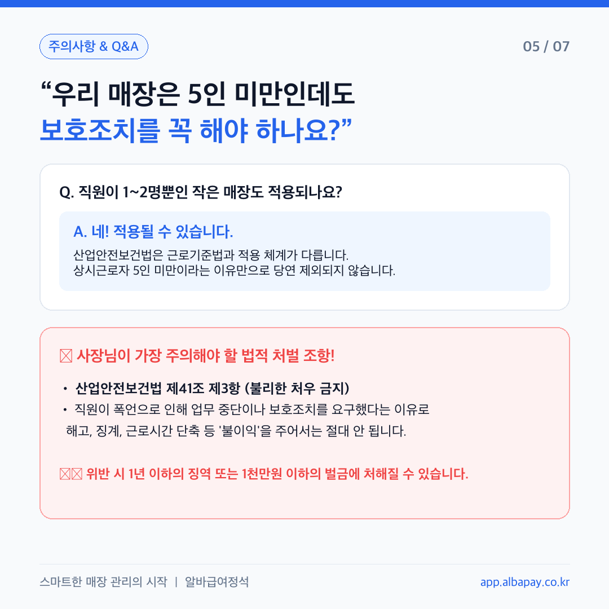
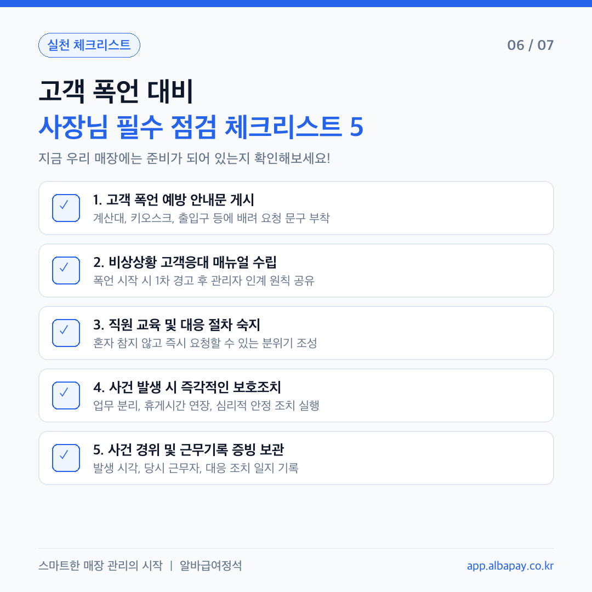
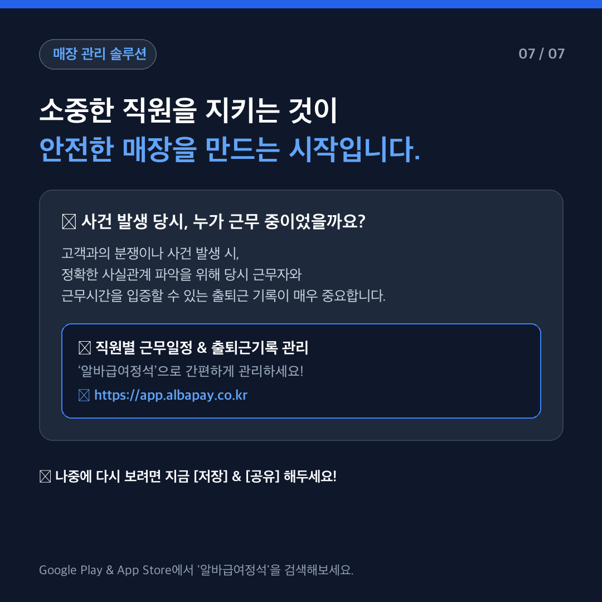

# 📢 손님이 알바에게 욕설했다면? ｜ 사장님이 해야 할 고객응대근로자 보호조치

인스타그램/SNS 업로드용 고화질 카드뉴스(1080x1080) 세트 및 게시용 피드 캡션 템플릿입니다.  
**산업안전보건법 제41조**에 따른 사업주의 필수 보호조치와 현장 대응 매뉴얼을 다룹니다.

---

## 🖼 카드뉴스 미리보기 (총 7장)

| 카드 01 (표지) | 카드 02 (실제 사례) | 카드 03 (법적 근거) |
| :---: | :---: | :---: |
|  |  |  |

| 카드 04 (대응 가이드) | 카드 05 (주의사항) | 카드 06 (체크리스트) | 카드 07 (아웃트로) |
| :---: | :---: | :---: | :---: |
|  |  |  |  |

> 💡 **웹 슬라이더 뷰어:** 저장소 내 [`index.html`](index.html) 파일을 열면 모바일/웹 브라우저에서 인터랙티브 슬라이더로 직접 넘겨보실 수 있습니다.

---

## 📝 인스타그램 업로드용 피드 캡션 (복사용)

> **인스타그램 피드 발행 시 아래 텍스트를 그대로 복사하여 본문에 붙여넣으세요.**

```markdown
“손님이 알바 직원에게 심한 욕설을 했습니다.
직원이 무서워서 더는 응대하지 못하겠다고 하는데, 사장님은 어떻게 해야 할까요?”

손님이 화를 낸다고 해서
직원에게 “손님이니까 네가 조금만 참아”라고 넘겨서는 절대 안 됩니다! 🙅‍♂️

산업안전보건법 제41조에 따르면,
고객의 폭언·욕설·폭행 등으로 직원에게 건강장해가 발생하거나
우려가 있는 경우, 사업주는 법적으로 즉각적인 보호조치를 취해야 합니다.

📌 사장님이 즉시 해야 할 4대 보호조치
1️⃣ 업무 일시 중단 및 분리 (사장님/관리자가 직접 인계)
2️⃣ 휴게시간 연장 및 휴식 보장
3️⃣ 치료 및 전문 심리상담 지원
4️⃣ 필요 시 경찰 신고 및 법적 대응 지원

⚠️ “우리 매장은 5인 미만인데요?”
산안법은 5인 미만 사업장이라도 보호조치 의무가 적용될 수 있습니다!
무엇보다 직원이 보호조치를 요구했다는 이유로 해고 등 '불이익'을 주면
1년 이하의 징역 또는 1천만원 이하의 벌금에 처해질 수 있습니다.

💡 고객과의 분쟁이나 사건이 일어났을 때,
가장 중요한 것은 “당시 누가, 몇 시에 근무하고 있었는가”를 증명하는 근태기록입니다.

직원별 근무일정과 출퇴근기록,
‘알바급여정석’으로 투명하고 확실하게 관리하세요!

👉 지금 프로필 링크에서 '알바급여정석' 무료 체험하기
🔗 https://app.albapay.co.kr

---
#고객응대근로자 #고객폭언 #악성고객대응 #알바직원보호 #산업안전보건법41조 #카페사장님 #식당사장님 #매장관리 #알바관리 #알바급여정석 #자영업자필수 #노무상식 #사장님그램
```

---

## 📂 파일 구조

```text
customer-response-cardnews/
├── output/
│   ├── card_01.png       # 01 표지
│   ├── card_02.png       # 02 실제 사례 (음료 제조 지연 폭언)
│   ├── card_03.png       # 03 사전 예방조치 3가지 (산안법 제41조)
│   ├── card_04.png       # 04 발생 시 즉각 대응 4대 조치
│   ├── card_05.png       # 05 5인 미만 매장 적용 여부 & 불이익 금지
│   ├── card_06.png       # 06 사장님 실천 점검 체크리스트
│   └── card_07.png       # 07 아웃트로 & 알바급여정석 솔루션
├── generate_cards.py     # Pillow 기반 1080x1080 고해상도 생성 스크립트
├── index.html            # 웹 반응형 카드뉴스 슬라이더 뷰어
└── README.md             # 안내 및 인스타 캡션 템플릿
```

---

## ⚖️ 관련 법령 및 참고 자료

- **산업안전보건법 제41조** (고객의 폭언 등으로 인한 건강장해 예방조치 등)
- **산업안전보건법 시행령 제41조** (제3자의 폭언등으로 인한 건강장해 발생 등에 대한 조치)
- **산업안전보건법 시행규칙 제41조** (고객의 폭언등으로 인한 건강장해 예방조치)
- **안전보건공단**: [https://www.kosha.or.kr](https://www.kosha.or.kr)
- **알바급여정석**: [https://app.albapay.co.kr](https://app.albapay.co.kr)
